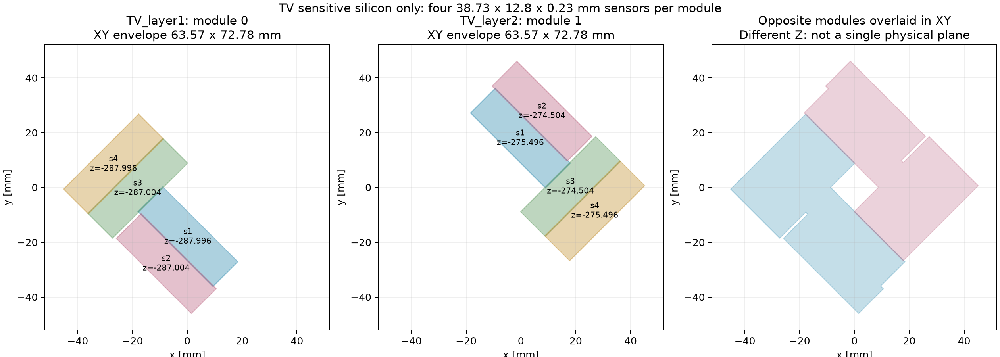
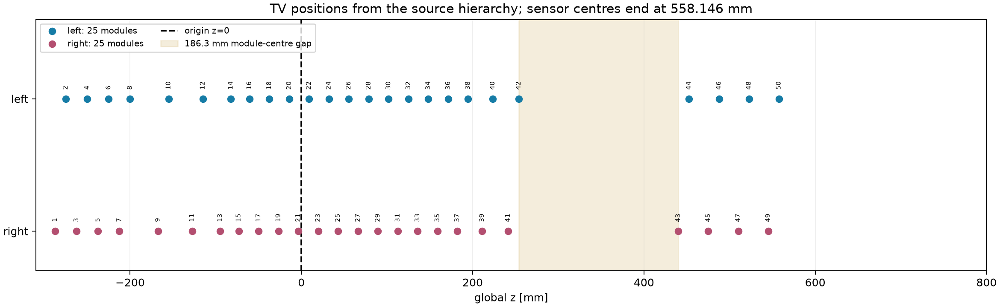
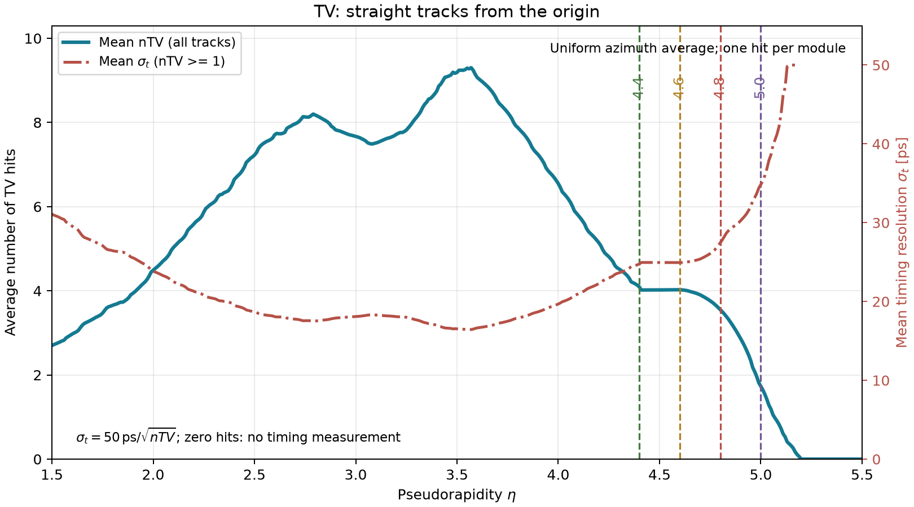
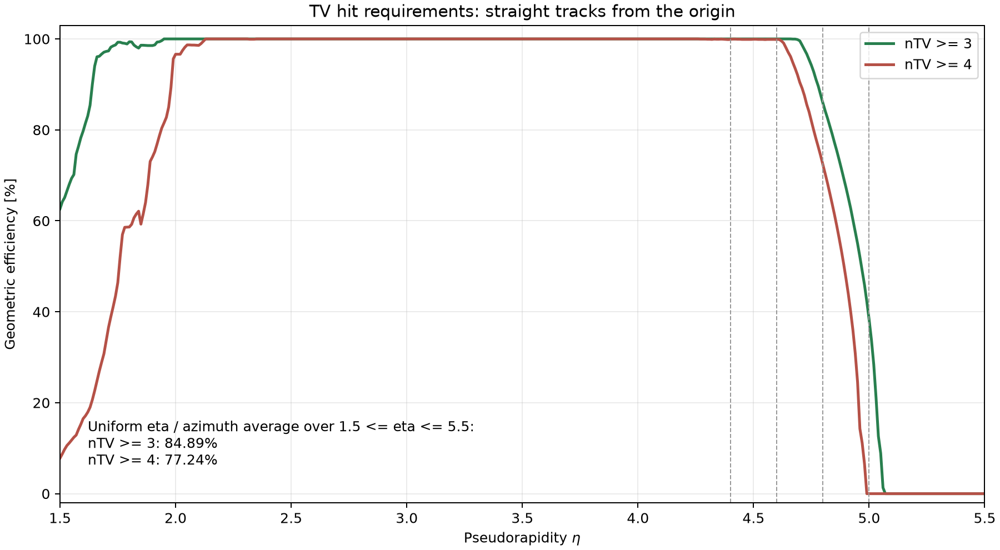

# TV Geometry and Origin-Track Acceptance Review

## Geometry Used for These Hit Counts

Source: `View_LHCb_run5/LHCb_lower-scenario-Sep2026.root`, using the global
placements in the TV hierarchy. This is not the original hand-made square
mockup and is not a new GDML extraction.

Only **`TV:SensorSilicon`**, volume `lvDet`, defines acceptance. Chip,
substrate, guard-ring silicon, support structures and enclosing volumes are
excluded. Each sensitive sensor is a rectangular box measuring
**38.73 x 12.8 x 0.23 mm**. Its full parent-to-global transform determines
the XY polygon and sensor-centre Z; the projected polygon is exact for the
source box. No hull across different sensors, artificial central hole or
filled sensor gaps are used.

| Property | Value |
|---|---:|
| Sensitive sensors | 200 |
| Physical modules / logical counting layers | 50 |
| Modules on each side | 25 |
| Sensors per module | 4 |
| Distinct sensor-centre Z planes | 100 |
| Separation of the two sensor planes within a module | 0.992 mm |
| Module XY bounding size | 63.565 x 72.775 mm |
| Module-centre Z range | -287.500 to 557.650 mm |
| Sensitive sensor-centre Z range | -287.996 to 558.146 mm |
| Downstream modules reachable from the origin | 29 |
| Upstream modules excluded for forward origin tracks | 21 |

Opposite-side modules have different Z positions; their XY overlay must not
be counted as a single physical plane. The central inactive region and small
sensor gaps arise naturally from the sensor union. Individual side masks
have an open inner exclusion, not a separately imposed closed square hole.



The source has a **186.3 mm module-centre gap** between Z=253.85 and 440.15 mm.
There is no sensitive silicon around Z=700 or 780 mm in this geometry.



## Counting Rule

For this study, a track is a straight forward ray born at `(0,0,0)`:

```text
tx = cos(phi) / sinh(eta)
ty = sin(phi) / sinh(eta)
x(z) = tx * z
y(z) = ty * z
```

Every downstream sensor polygon is tested at its own centre Z. Boundaries
count as hits. If any sensor in a module is intersected, that module adds
**one** to `nTV`; multiple sensors hit within the same module do not add
extra hits. Logical labels `TV_layer1` through `TV_layer50` follow increasing
Z, with original ROOT module IDs retained in the inventory.

The prior saved module-union XY outlines match these sensor polygons exactly.
However, the prior simplified masks placed the entire union at module-mean Z.
This study instead uses `../review/tv_sensor_masks.pickle`, retaining each
sensor's Z. The loader-compatible equivalent is `../review/sensor_setup` with
`exact_surfaces=True`. All registered full-detector configurations now use
this same sensor-resolved geometry, built from the canonical
`detector_setups/tv_sensor_geometry.json` inventory.

## Mean Hits and Expected Timing

Uniformly average over azimuth at fixed eta, including zero-hit directions
in the mean hit count. No magnetic field, material, sensor inefficiency,
vertex spread or reconstruction requirements are applied.

For the requested timing toy, assume independent equal-precision hits:

```text
sigma_t(track) = 50 ps / sqrt(nTV(track))
```

The right axis averages this resolution **track by track for nTV >= 1**.
Zero-hit tracks have no timing measurement; bins with no positive-hit tracks
have no timing point. This is not `50 / sqrt(mean(nTV))`. It also does not
include common timing errors or correlations between hits. The CSV additionally
provides mean resolutions conditional on nTV>=3 and nTV>=4.



## Hit-Cut Efficiency: 1.5 <= eta <= 5.5

At each eta, efficiency is the fraction of all azimuth directions satisfying
the cut, including zero-hit rays in the denominator. The scan uses 401 eta
values spaced by 0.01 and 2880 midpoint azimuth samples per eta: **1,154,880
rays**. These are geometric efficiencies, not measured tracking efficiencies.

| eta | Mean nTV | nTV >= 3 | nTV >= 4 |
|---|---:|---:|---:|
| 1.5 | 2.70 | 62.64% | 7.81% |
| 2.0 | 4.49 | 100.00% | 96.63% |
| 3.5 | 9.19 | 100.00% | 100.00% |
| 4.4 | 4.09 | 100.00% | 99.90% |
| 4.6 | 4.02 | 100.00% | 99.86% |
| 4.8 | 3.55 | 85.90% | 72.36% |
| 5.0 | 1.73 | 38.26% | 0.00% |
| 5.5 | 0.00 | 0.00% | 0.00% |



**Integrated over 1.5 <= eta <= 5.5, with uniform eta and azimuth weighting:**

- nTV >= 3: **84.89%**.
- nTV >= 4: **77.24%**.
- Mean nTV, including all rays: **5.265**.

These integrated numbers depend on the assumed eta distribution; they are
not predictions for a physics sample. A real track sample should be weighted
by its own eta/phi and vertex distributions. The high-eta loss occurs as rays
remain inside the central inactive region out to the last active sensors.

Doubling azimuth sampling to 5760 changes the efficiency curves by at most
0.105 percentage points for >=3 and 0.157 points for >=4, and the mean count
by at most 0.00348 hits. This checks angular discretization, not geometry or
physics uncertainties; eta discretization is 0.01.

## Files and Reproduction

`tv_eta_acceptance.csv` contains the curves and conditional timing resolutions.
`tv_eta_phi_hits.npz` contains per-ray hit counts, while `summary.json` records
the input, assumptions and convergence checks.

```bash
PYTHONPATH=src MPLCONFIGDIR=/private/tmp/xyshapes-mpl \
  python examples/toy_tv_eta_acceptance.py \
  --eta-min 1.5 --eta-max 5.5 --n-eta 401 --n-phi 2880 \
  --output docs/TV/geometry_review
```

Focused tests cover upstream exclusion, counting once per module, sensor Z,
gaps, eta-to-slope conversion and averaging timing per track with undefined
zero-hit timing.
